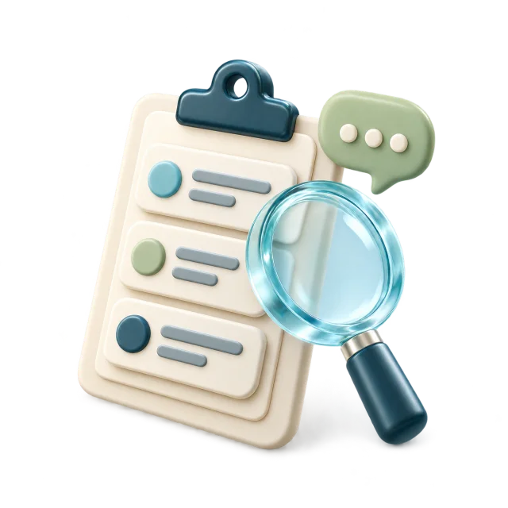
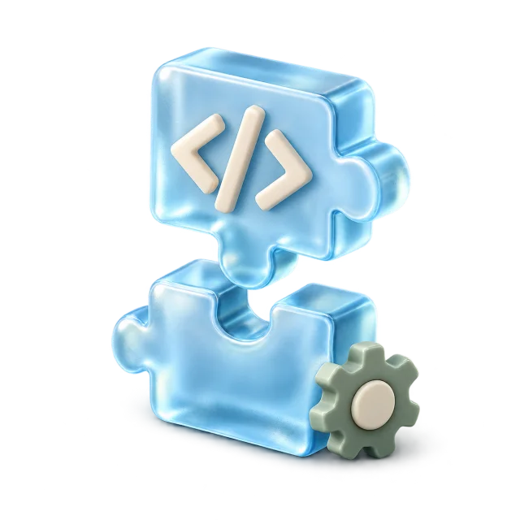
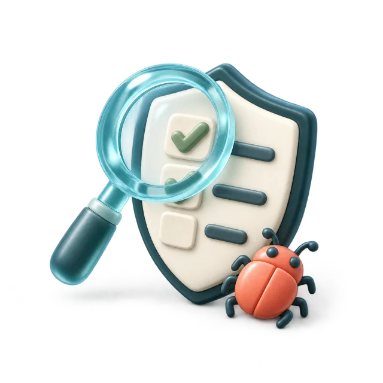
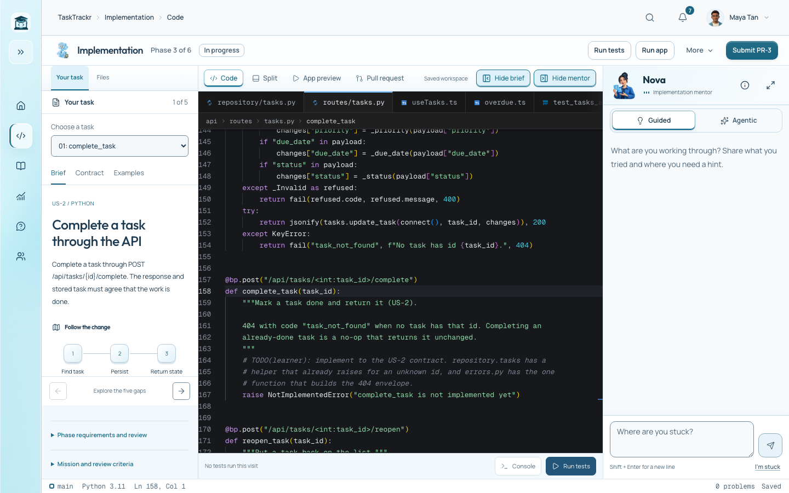
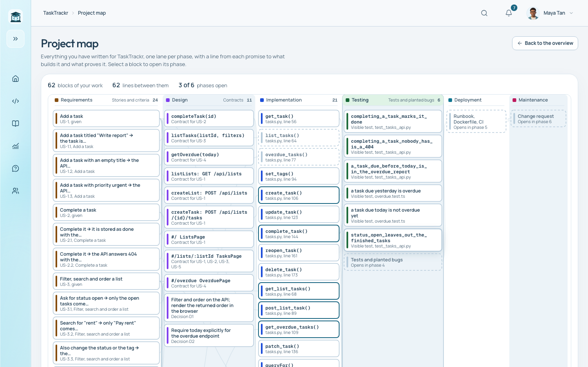
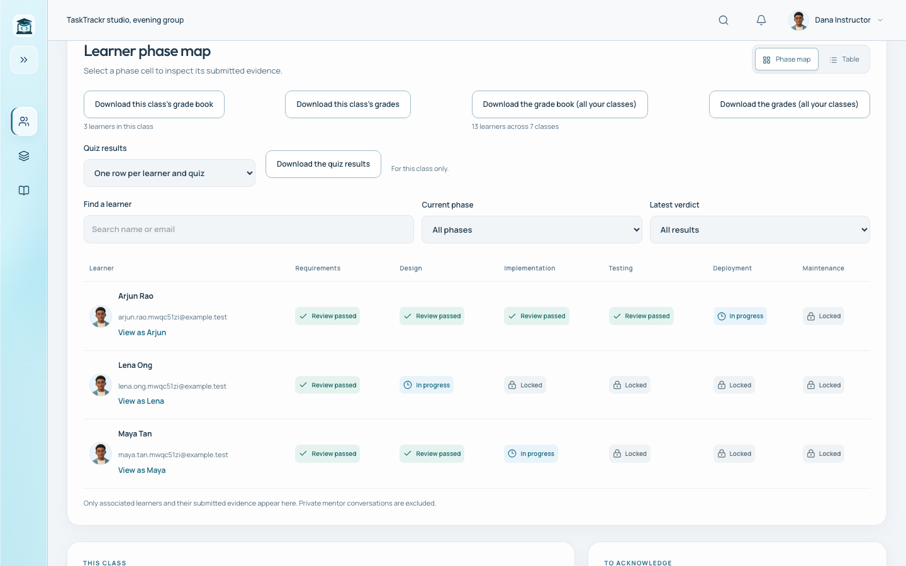
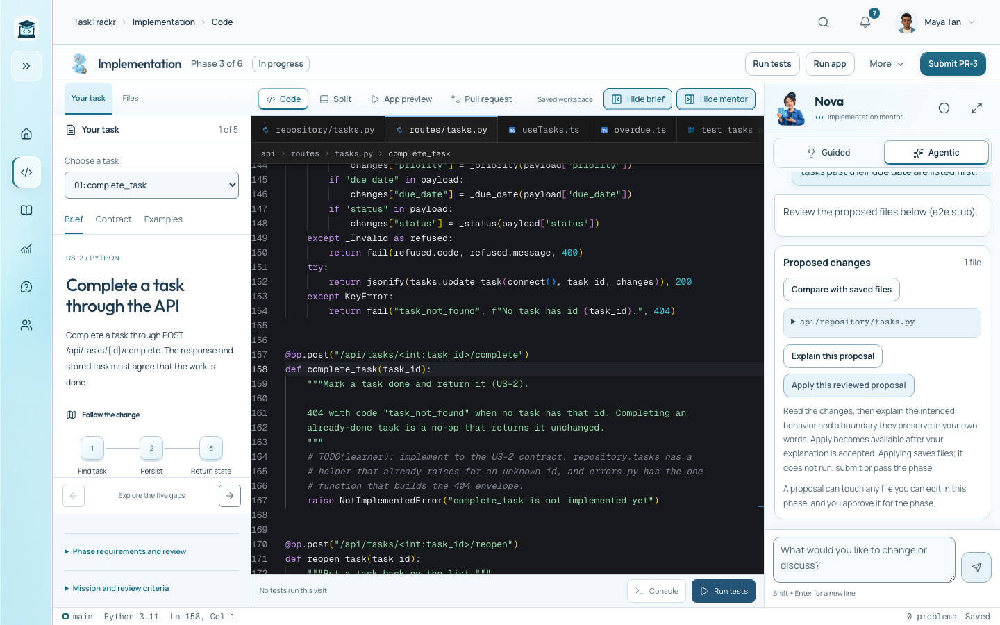
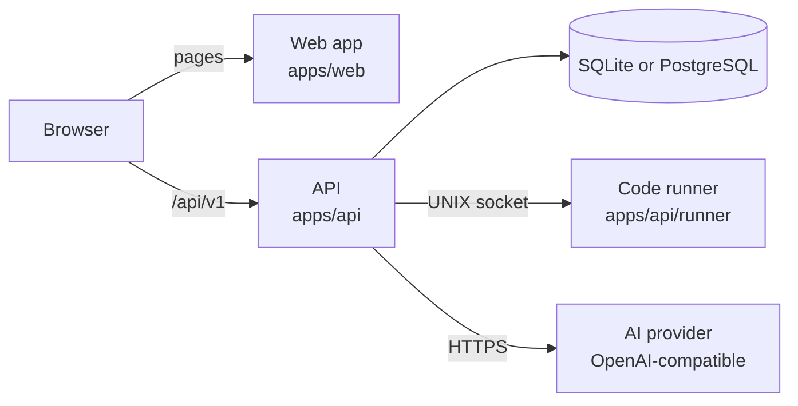

<p align="center">
  
</p>

<h1 align="center">LearnSDLC</h1>

<p align="center">
  <strong>You already know how to code.</strong><br>
  Carry one real project through every phase of the software development life cycle,<br>
  with a mentor that refuses to write your answer.
</p>

<p align="center">
  A product of the <strong>SMU School of Computing and Information Systems</strong>, built by team <strong>SMUTors!</strong>
</p>

<p align="center">
  
  
  
  
  
  
  
  
  
  
</p>

<p align="center">
  
</p>

<table align="center">
<tr>
<td align="center" valign="top" width="16%"><br><a href="#what-you-get"><strong>Requirements</strong></a><br><sub>an issue form</sub></td>
<td align="center" valign="top" width="16%"><br><a href="#what-you-get"><strong>Design</strong></a><br><sub>a design editor</sub></td>
<td align="center" valign="top" width="16%"><br><a href="#what-you-get"><strong>Implementation</strong></a><br><sub>a pull request</sub></td>
<td align="center" valign="top" width="16%"><br><a href="#what-you-get"><strong>Testing</strong></a><br><sub>a kill matrix</sub></td>
<td align="center" valign="top" width="16%"><br><a href="#what-you-get"><strong>Deployment</strong></a><br><sub>an incident drill</sub></td>
<td align="center" valign="top" width="16%"><br><a href="#what-you-get"><strong>Maintenance</strong></a><br><sub>a change request</sub></td>
</tr>
</table>

LearnSDLC from SMU SCIS is a web application for learning the software development life cycle by doing it. A learner takes one small software project through the phases of the life cycle, from requirements through design, implementation, testing and deployment to maintenance. Each phase is checked automatically before the next one opens: rule checks, visible and hidden tests run in a sandbox, static analysis, and an AI review of every criterion. An AI mentor sits beside the work. It reviews, explains and asks questions, and it refuses to hand out answers. Teachers get a console for their classes, and can upload or customise projects of their own. The built-in project is TaskTrackr, a small task tracker with a Python API over SQLite and a TypeScript React front end.

It is for teachers who want to run a hands-on software engineering class, and for developers who want to change or extend it.

<table>
<tr>
<td width="50%" valign="top"><br><sub><strong>A learner's phase room.</strong> The task brief and the files on the left, the editor in the middle, the mentor on the right.</sub></td>
<td width="50%" valign="top"><br><sub><strong>The project map.</strong> Everything a learner has written for the project, one lane per phase, with a line from each promise to what builds it and what proves it.</sub></td>
</tr>
<tr>
<td width="50%" valign="top"><br><sub><strong>The teacher console.</strong> A class's learners, phase by phase.</sub></td>
<td width="50%" valign="top"><br><sub><strong>The Agentic mode.</strong> A proposed change waits for the learner's explanation before it can be applied. The reply shown comes from the test mentor that ships for trials without an AI key.</sub></td>
</tr>
</table>

## What you get

**For learners**

- A room for each phase, shaped like the work: a story form in Requirements, with a stakeholder interview; a Design room with a UML model, an API contract, screens, a sequence diagram and decisions; a code editor in Implementation, Testing and Deployment; and a change room in Maintenance.
- **Run** for the visible tests, and **Run app** in Implementation, Testing and Maintenance, which starts the learner's own application and shows it in the page.
- Submissions graded against a rubric, with a gate at 70 out of 100. From Implementation on, each submission opens or updates a pull request. Testing shows a kill matrix: the learner's tests against copies of the application with one bug planted in each. Deployment has an incident drill.
- A mentor that critiques and explains. A request for the finished answer gets a hint in the form of a question.
- An Agentic mode that proposes a change, asks the learner to explain it, and applies it only when the explanation shows understanding.
- The project map, a journal, lessons for each phase, the reference solution once a phase has passed, and the whole project to take away as a real git repository and as a printable dossier.

The [user guide](docs/user-guide.md) walks through all of it.

**For teachers**

- Classes with 8-character join codes, a roster phase by phase, and each learner's evidence and submissions.
- Phase levers (mark as passed, reopen, reset, regrade), each with a written reason in an audit trail, and a read-only **View as** of a learner's own view.
- Release and due dates, sign-off of marked tasks, grade downloads as CSV, and quiz results as charts and CSV.

**For authors**

- A teacher can copy a project and edit it, or upload one as a `.zip` archive: any of the six phases, at least one, in order.
- Hidden tests, reference solutions and planted bugs are written through sealed doors and never shown back to learners.
- Deep validation runs the draft in the sandbox (the solution passes, the starting files fail, every planted bug is caught) before it can be published. A learner preview, publishing to a class, and export complete the path.

[Teacher project upload](docs/teacher-project-upload.md) is the teacher's guide and [authoring format](docs/authoring-format.md) describes the archive.

**What keeps learner code contained**

- Learner code runs in a separate Python process (`apps/api/runner`), reached over a UNIX socket, never inside the API.
- Each run gets limits on CPU time, memory, processes, file size and open files, a wall-clock timeout, a scrubbed environment and no network. A kernel fence (Landlock) lets it reach only its own workspace.
- Hidden tests and reference answers are kept outside the learner's workspace and removed before learner code loads.
- Where the kernel cannot provide that fence, the runner refuses every run. Nothing falls back to running learner code unconfined.

## Quick start

Learner code runs only where the kernel can isolate it: Linux with Landlock (kernel 5.13 or newer), or Docker on macOS and Windows, which runs the containers in a Linux virtual machine. On a Mac that means Colima, not Docker Desktop, whose virtual machine has no Landlock. On a Mac without Docker the product starts and every page works, but running, testing and grading learner code is refused.

Every command runs from the repository root. First, the AI key:

```bash
git clone <repository URL> learnsdlc
cd learnsdlc
cp .env.example .env
# open .env and set OPENAI_API_KEY=<your key>
```

### With Docker: the full product, on any machine

You need Docker with Compose 2.24 or newer (Colima on a Mac, Docker Engine on Linux), Node (the scripts use it to write the sandbox manifest and create the demo instructor; `nvm install` installs the version in `.nvmrc`), Python 3.11 or newer (to write that manifest), `curl`, and about 10 GB of free disk. Docker should have about 6 GB of memory; the script warns below that.

```bash
npm run demo -- --docker
```

It checks the key, Docker, the ports, the disk and the memory, generates this machine's secrets into `.env.verify`, builds the images, starts the stack and waits until every service is healthy. When it works it prints a block that starts `==> LearnSDLC is running (Compose project learnsdlc)` and names:

- the web app at http://localhost:3080, the API at http://localhost:4080/api/v1 and the captured mail at http://localhost:5085, all on 127.0.0.1 only;
- the instructor `instructor@learnsdlc.test` and the administrator, whose passwords were generated for this machine and are in `.env.verify` (`STACK_INSTRUCTOR_PASSWORD`, `ADMIN_EMAIL` and `ADMIN_PASSWORD`). Nothing prints a password.

Register a learner at http://localhost:3080/register. Press ctrl+c to stop.

### Natively: for working on the code

You need Node 24.9 or a later 24 (or Node 26 and later; `nvm install` installs the version in `.nvmrc`), Node 22 as well (learner JavaScript runs on it: `nvm install 22`, or set `NODE_BIN`), Python 3.11 exactly, `curl`, `lsof` or `ss`, and ports 3000 and 4000 free.

```bash
npm run demo
```

It checks the machine, installs and builds what is missing, migrates the database at `data/learnsdlc.sqlite` and starts the code runner, the API and the web app. When it works it prints `==> LearnSDLC is running` with the web app at http://localhost:3000 and the API at http://localhost:4000. It seeds two demo staff accounts, `instructor@learnsdlc.test` with the password `Instructor123!` and `admin@learnsdlc.test` with `Admin123!` (`SEED_PASSWORD` replaces both). These are demo-only: they are created only while the API is bound to a loopback address and `NODE_ENV` is not `production`, and wherever the API is reachable from the network, sign-in refuses them.

On a Mac, and on any kernel without Landlock, the demo still starts and says so:

```text
  warn  this machine cannot isolate learner code (the runner says: kernel-isolation-unavailable).
  warn  The demo still starts, but Run, Submit and Preview of learner code are refused here.
  warn  For those, use npm run demo -- --docker (Colima on a Mac, Docker Engine on Linux).
```

[Running it on your own machine](docs/local-run.md) covers both modes in full: every option, the ports, where the data lives, resetting, the proof script and Windows.

### Hosting a class

`npm run host` serves the native mode to a room on the local network, from a Linux machine with Landlock. It refuses to host on a Mac or on any kernel without Landlock. It asks for the first administrator, keeps a generated session secret in `data/host.env`, rebuilds the web app when the machine's address has changed, and prints the address with a QR code. In place of the demo's settings it sets `API_BIND=0.0.0.0`, its own `JWT_SECRET`, `ADMIN_EMAIL` and `ADMIN_PASSWORD`, `RUNNER_MODE=socket` with the runner it starts, `SEED_DEMO_ACCOUNTS=false`, `NODE_ENV=production`, and `WEB_ORIGIN` and `NEXT_PUBLIC_API_URL` for the room's address. It is plain HTTP, for an afternoon. See [Hosting a class from one laptop](docs/local-run.md#hosting-a-class-from-one-laptop).

### Running in production

The supported deployment is `docker compose` on one Linux host, with Caddy for TLS, PostgreSQL, Redis, the runner in its own container and a daily backup. The [production runbook](docs/production-runbook.md) is the deploy path. A reference AWS deployment is described in [docs/deployment/preview.md](docs/deployment/preview.md).

## The AI key

The mentor, the stakeholder interview, the Agentic mode and its explanation check, and the AI review in every graded submission all call a model. The person running LearnSDLC supplies the key.

- Put `OPENAI_API_KEY` in `.env`. The default model is `gpt-5.6-luna` at OpenAI.
- Any OpenAI-compatible Chat Completions endpoint works: set `OPENAI_BASE_URL`, `OPENAI_MODEL` and `OPENAI_API_KEY`. See [Bring your own hosted model](docs/local-run.md#bring-your-own-hosted-model).
- The key is read only by the API. It never reaches the browser.

Without a key the local-run scripts refuse to start and say where the key goes. The API itself still starts without one: every page works, the mentor and the Agentic mode say the AI is not configured, and a submission's AI review is recorded as unavailable, so no task can pass except a quiz.

For tests and a trial without a key, `--ai-stub` starts a canned test endpoint (`e2e/ai-stub.cjs`) in place of a model: `npm run demo -- --ai-stub`, or `npm run demo -- --docker --ai-stub`. It is not a model. It passes only work that carries the test marker `E2E-PASS`, and it is used only when asked for by name.

## How it is built

- The web app (`apps/web`, Next.js) draws the pages. They run in the browser and call the API directly.
- The API (`apps/api`, NestJS) serves `/api/v1`, grades submissions on a job queue and calls the AI provider.
- Data lives in one SQLite file on a laptop, or in PostgreSQL with Redis in a deployment, built by versioned migrations.
- The code runner (`apps/api/runner`, Python) runs learner code in a separate process behind a UNIX socket.
- `packages/shared` holds the types, limits and contract the API and the web app share.



The [architecture](docs/architecture.md) explains each part and how a submission is graded.

## Repository layout

| Folder | What it holds |
|---|---|
| `apps/api` | The NestJS API, its migrations, command-line tools and tests |
| `apps/api/runner` | The Python code runner and static analyser |
| `apps/web` | The Next.js web app |
| `packages/shared` | Types, limits and the HTTP contract shared by the API and the web app |
| `content` | The built-in reference project, TaskTrackr |
| `e2e` | The Playwright browser tests and the canned AI endpoint |
| `scripts` | The local-run scripts, the proof, the sandbox's pre-bake, backups and their tests |
| `infra` | The runner image, the Caddy configuration and a reference AWS deployment |
| `docs` | The documents |
| `.github` | The CI workflow and the issue and pull request forms |

At the root: `docker-compose.yml` (the production stack), the local stack's overlays `docker-compose.verify.yml`, `docker-compose.ai-stub.yml` and `docker-compose.localstack.yml`, `.env.example` (every setting, with placeholders) and `playwright.config.ts`.

## Tests

| Suite | Command |
|---|---|
| Type-check | `npm run typecheck` |
| API and shared specs (Jest) | `npm run test -w @learnsdlc/api` |
| Web tests (Vitest) | `npm run test:web` |
| Copy rules | `npm run lint:copy -w @learnsdlc/web` |
| Script tests | `npm run test:scripts` |
| Runner tests (pytest) | `npm run test:runner` |
| Infrastructure tests | `npm run test:infra` |
| Content check | `npm run content:check` |
| Browser tests (Playwright) | `npm run e2e` |
| The full local proof | `bash scripts/prove-local.sh` |

`npm test` runs the API specs, the web tests and the runner tests in turn. Tests that run learner code need Linux with Landlock; on a Mac they fail by design. The [testing guide](docs/testing.md) says what each suite proves and needs.

## Documentation

- [Running it on your own machine](docs/local-run.md)
- [User guide](docs/user-guide.md) and [teacher project upload](docs/teacher-project-upload.md)
- [Architecture](docs/architecture.md), [development](docs/development.md) and [testing](docs/testing.md)
- [Configuration](docs/configuration.md), [HTTP API](docs/api.md) and [troubleshooting](docs/troubleshooting.md)
- [Production runbook](docs/production-runbook.md)
- [Every document](docs/README.md)

## Contributing, security and licence

- **Contributing:** read [CONTRIBUTING.md](CONTRIBUTING.md) and the [code of conduct](CODE_OF_CONDUCT.md).
- **Security:** report a vulnerability privately, as [SECURITY.md](SECURITY.md) says.
- **Licence:** no licence has been chosen yet; until a LICENSE file is added, all rights are reserved. Third-party material is listed in [THIRD_PARTY.md](THIRD_PARTY.md).
