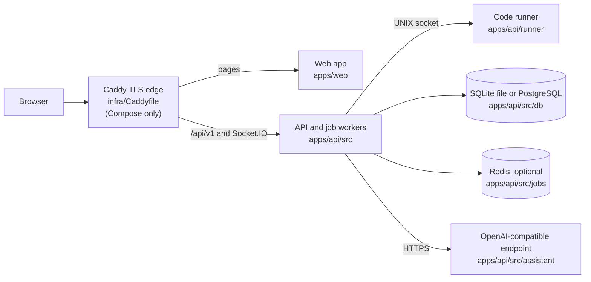
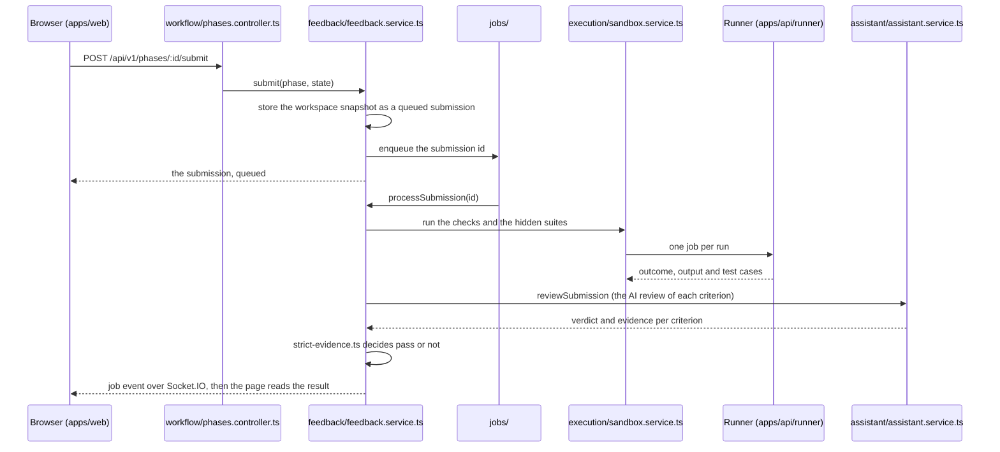
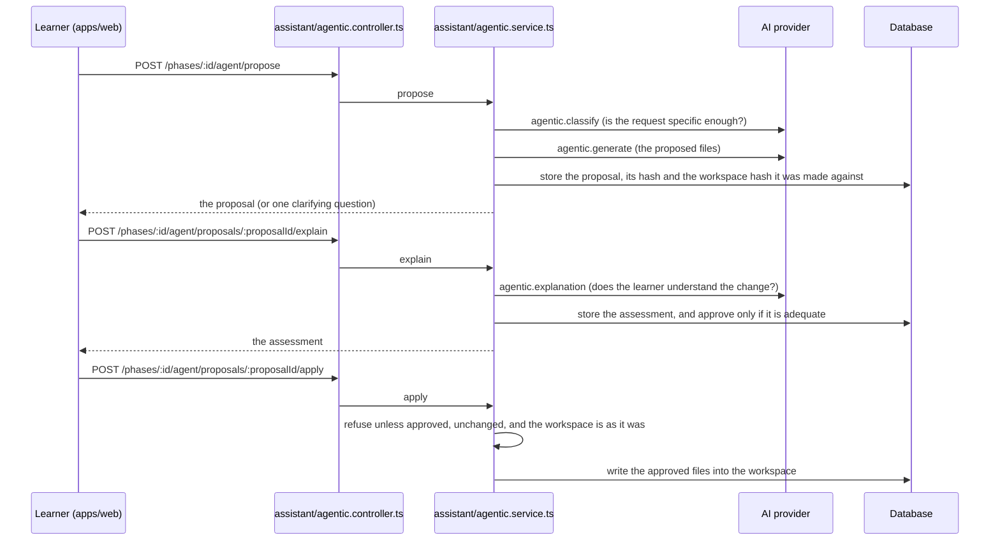
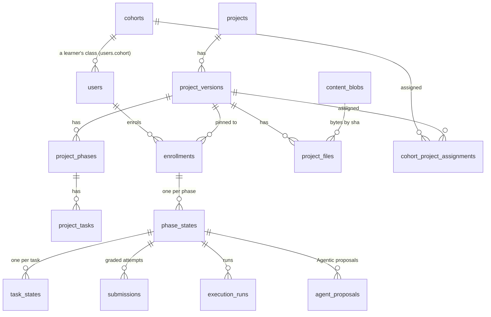

# LearnSDLC architecture

LearnSDLC is a web application for learning the software development life cycle by doing it. A learner carries one project through six phases (Requirements, Design, Implementation, Testing, Deployment and Maintenance); each phase is graded before the next one opens, and an AI mentor helps without doing the work. A teacher runs a class, reads the evidence and can upload projects of their own.

This page is the one to read first if you want to change the code. It says what the parts are, which folder holds each, and which module decides what. Every box in the diagrams names the folder it lives in, so you can check it against the tree.

Read next:

- [Development guide](development.md): the layout of each workspace, the everyday commands and how to add a migration, a route, a page or a test.
- [Testing guide](testing.md): every test suite and what it needs.
- [Running it on your own machine](local-run.md), the [configuration reference](configuration.md) and the [HTTP API overview](api.md).
- [Production runbook](production-runbook.md) for running it for a class.

## What every machine can and cannot do

Learner code (Run, Submit and the live preview of a learner's application) runs only where the kernel can isolate it: Linux with Landlock (kernel 5.13 or later), or Docker on macOS and Windows, where the containers run inside a Linux virtual machine. Everywhere else, a Mac without Docker for example, the product starts and every page works, but the code runner reports that it cannot isolate learner code and refuses every run, submission and preview of learner code with a sentence that says so. Nothing falls back to running learner code unconfined. See [The code runner](#the-code-runner) below.

The AI features need an API key for an OpenAI-compatible provider, supplied by whoever runs the product. See [The AI path](#the-ai-path).

## The workspaces

The repository is one npm workspace. The root `package.json` names `packages/*` and `apps/*`.

| Folder | Package | What it owns |
|---|---|---|
| `apps/web` | `@learnsdlc/web` | The Next.js site: the public pages, sign-in, the learner's map, the phase rooms and editor, lessons, progress, and the teacher and administrator consoles. Its pages run in the browser and call the API directly. |
| `apps/api` | `@learnsdlc/api` | The NestJS API under `/api/v1`, its Socket.IO gateway, the grading and run job workers, the database migrations and the command-line tools under `src/cli`. |
| `apps/api/runner` | (Python, no package) | The code runner: `serve.py` (the socket server), `sandbox_runner.py` (one finite job), `app_session.py` (a learner's running application), `analyzer.py` (static analysis) and `lambda_handler.py` (the same job contract as an AWS Lambda function). |
| `packages/shared` | `@learnsdlc/shared` | Types, limits and pure functions the API and the web app must agree on: the phase order, the HTTP contract under `src/contract`, the structured record formats, the project pack layout and the upload contract. The browser bundle imports it, so nothing secret belongs there. |
| `content/` | | The built-in reference project, TaskTrackr, as a pack on disk. |
| `e2e/` | | The Playwright browser tests and the canned AI endpoint they grade against (`e2e/ai-stub.cjs`). |
| `scripts/` | | The local-run scripts, the pre-bake of the sandbox's libraries, backups, the end-to-end journey scripts and their `node:test` tests. |
| `infra/` | | The runner image (`runner.Dockerfile`), the Caddy edge, and a reference AWS deployment under `infra/preview` and `infra/microvm`. |
| `docs/` | | These documents. |

## The containers

On a laptop there is no edge: the browser loads pages from the web app on port 3000 and calls the API on port 4000. The web app keeps no data of its own and never opens the database. Its pages fetch what they show from the API in the browser, at the address `NEXT_PUBLIC_API_URL`, which is built into the bundle when the web app is built.

The Compose file `docker-compose.yml` runs the same parts as containers: `caddy`, `web`, `api`, `runner`, `postgres`, `redis` and a `backup` container that dumps the database on a schedule. The runner shares only a socket volume with the API.

## One request, from the browser to the database

1. A page under `apps/web/app` calls a function in `apps/web/lib/api*.ts`, which sends the request with the session token as a `Bearer` header.
2. `configureApp` in `apps/api/src/main.ts` wraps every request, in this order: compression, security headers, the live preview's own CORS preflight, the CORS allow list (`WEB_ORIGIN`), the body parsers (a class import and a project upload each have their own parser and size limit, everything else 4 MB of JSON), request logging, and a validation pipe that strips any field a DTO does not declare.
3. Two global guards run on every route (`apps/api/src/app.module.ts`): `JwtAuthGuard` refuses a request without a valid token unless the route is marked `@Public()`, and `RolesGuard` checks `@Roles(...)`. A route that can be abused also carries `@RateLimit(count, seconds)` with `RateLimitGuard`.
4. The controller hands the request to a service. A service that reads a learner's work asks `WorkflowService.loadOwnedState`, which refuses a phase that is not the caller's own.
5. The service reads and writes through TypeORM repositories (`apps/api/src/db`). Long work (grading, a run) is put on the job queue instead of being done in the request.
6. When a job finishes, `EventsGateway` (`apps/api/src/events`) tells the learner's open pages over Socket.IO, and the page reads the result from the API.

## The API inside

The API is one NestJS application: `AppModule` lists its controllers and providers, with `DatabaseModule` and `DemoModule` beside it. Its folders under `apps/api/src`:

| Area | Folders |
|---|---|
| Accounts and sign-in | `auth` (passwords, sessions, Google sign-in, the optional Amazon Cognito mode, role guards, rate limits, recovery), `account`, `admin`, `mail`, `identity-migration` |
| Projects and content | `content` (the pack loader, compiler, importer and project registry), `authoring` (teacher uploads, editing, deep validation, export), `seed` (what the API creates at boot) |
| The learner's work | `workflow` (enrolments, phase states, saves, advancing, resets, the reference solution), `execution` (runs and the gate in front of the runner), `preview` (the live preview of a learner's application), `feedback` (submissions and grading), `quiz`, `repo` (the learner's project as a git repository), `notifications` |
| AI | `assistant` (the phase mentors, the stakeholder interview, Guided drafts, Agentic proposals and their explanation check, the AI review of a submission) |
| Teaching | `instructor`, `classroom`, `analytics` |
| Platform | `config.ts` and `config/` (every environment variable the API reads), `db` (the data source and the migration runner), `migrations`, `jobs`, `events`, `health`, `observability`, `retention`, `audit`, `demo`, `cli` |

The health routes are `GET /api/v1/health`, `/api/v1/health/live` and `/api/v1/health/ready`. Prometheus metrics are served at `/metrics`, outside the API prefix.

## How work is graded

Which module decides what:

- **The submission.** `FeedbackService.submit` stores the workspace as a queued submission and enqueues only its id; the worker reloads everything from the database. One learner has at most one submission in flight per task: the database enforces it with a unique index, and pressing Submit again returns the same submission.
- **The queue.** `apps/api/src/jobs`: BullMQ on Redis when `REDIS_URL` is set, otherwise an in-process queue. Processing leases and conditional writes stop a stale worker from overwriting a newer result.
- **The checks.** `apps/api/src/feedback` runs the phase's rule checks (`checkers.ts`) and, for code and test tasks, the runner's test results: the visible tests, the hidden suites and, in Testing, the learner's tests against copies of the application with one bug planted in each.
- **The AI review.** `AssistantService.reviewSubmission` asks the provider for a verdict on every rubric criterion. Without a provider the review is recorded as unavailable.
- **The pass.** `strictTaskEvidencePassed` in `apps/api/src/feedback/strict-evidence.ts` is the one rule: the review is available and covers every criterion exactly once, every required check passed, a code or test task has a non-empty suite that is fully green, and the reviewer's verdict is a pass. The one exception is written in `reviewerVerdictIsAdvice` (`packages/shared/src/contract/feedback.ts`): at a rule-based score of exactly 100, a reviewer that found more than half of the criteria met is shown as advice instead of refusing. A quiz passes on its own mark (`quizPassed`), with no AI review.
- **The phase gate.** Advancing is a transaction in `WorkflowService` that asks `requiredTasksWithoutEvidence` (`apps/api/src/workflow/strict-gate.ts`) of every required task of the phase, under a lock on the enrolment. The room and the gate read the same rule, so the page never offers Continue over a gate that would refuse. A teacher's Mark as passed is recorded in the audit trail.
- **The explanation gate.** In the Agentic mode the learner must explain a proposed change, and the explanation must be assessed as showing understanding, before the change can be applied. See [The AI path](#the-ai-path).

## The code runner

The API never runs learner code in its own process outside development. `RUNNER_MODE` (`apps/api/src/config/runner.ts`) chooses the transport, and `SandboxService` (`apps/api/src/execution/sandbox.service.ts`) speaks to it:

| `RUNNER_MODE` | Where code runs | Live preview |
|---|---|---|
| `socket`, and any unset or unknown value | `serve.py`, behind the UNIX socket at `RUNNER_SOCKET` | Yes |
| `local` | `sandbox_runner.py` as a child of the API process. Refused at boot in production and on any bind address that is not loopback. Used by the test suites. | Yes, through a private runner the API starts |
| `lambda` | The AWS Lambda function named by `RUNNER_LAMBDA_FUNCTION` (`lambda_handler.py`). Python only. | No |

Every transport speaks the same job contract: a JSON job in (the files, the graded files, the mode, the language, the limits) and a JSON result out (the outcome, the output, the test cases, diagnostics and the isolation status). Over the socket, `POST /execute` runs a job to completion and the `/app/*` routes supervise a learner's running application for the live preview.

What the runner guarantees for each run (`apps/api/runner/sandbox_runner.py`):

- a child process with limits on CPU time, memory, processes, file size and open files, a wall-clock timeout, and a scrubbed environment;
- a file fence: Landlock in the kernel, which lets the child reach only its own workspace and the read-only system and runtime directories, and the same rule written into every Python child as a second layer;
- graded material (the reference implementation, the planted bugs, the hidden suites) written outside the learner's workspace and removed before learner code loads;
- no network during a run: the runner blocks sockets inside every child, and in Compose the runner container has no network at all;
- no package manager during a run: the libraries learner code may import are built ahead of time into a pre-baked layer (`npm run prebake`, `scripts/prebake.mjs`).

The kernel fence is armed only after a self-test has started each interpreter under it. Where Landlock is missing (macOS, Windows, an older Linux kernel, a seccomp profile that hides it), where the self-test fails, or where `SANDBOX_LANDLOCK=0` switches it off, the runner reports its isolation as `unsupported` and refuses every learner run and preview. The one exception is a runner started by the MicroVM supervisor of the reference AWS deployment, where a fresh virtual machine per job is the boundary.

In Compose the runner is its own container: an unprivileged user, no network, a read-only root filesystem, every capability dropped and a process limit. `RUNNER_SLOTS` bounds the runs that may exist at once; a caller that waits longer than `RUNNER_MAX_WAIT_MS` for a slot is told the runner is busy.

The [reference AWS deployment](deployment/preview.md) keeps the socket contract but puts a [MicroVM controller](deployment/microvm-controller.md) behind it, so each finite job runs in a fresh AWS Lambda MicroVM and each preview in a MicroVM of its own.

## The AI path

The API calls one OpenAI-compatible Chat Completions endpoint (`apps/api/src/assistant/openai.provider.ts`): `OPENAI_BASE_URL`, `OPENAI_API_KEY` and `OPENAI_MODEL`. Calls are bounded by a timeout per call and by a limit on open calls per process, and one learner's calls run one at a time. Every call has one of ten labels (`guided.draft`, `guided.review`, `interview.answer`, `interview.review`, `grading.review`, `agentic.classify`, `agentic.generate`, `agentic.generate.edits` while `AI_AGENTIC_EDIT_LIST` is not `off`, `agentic.explanation`, `structured.other`) that the logs and metrics use; the [production runbook](production-runbook.md) lists them.

What reaches the learner is checked first, and nothing is streamed:

- A request for a finished answer is caught by a rule (`isSolutionRequest` in `apps/api/src/assistant/guardrails.ts`) and answered with a hint in question form, without a model call.
- A question about another phase is redirected without a model call.
- A mentor reply is reviewed by a second model call (`guided.review`) and then passed through the output guardrails, which withhold the reference solution, hidden tests, long code blocks and a reply that amounts to the finished artefact. A reply that fails is not shown; the learner is told so and may ask again.

The Agentic mode is two steps with the learner's explanation between them:

The API applies a proposal only against the exact version the learner explained (its hash) and the workspace it was made for; editing a proposal clears its approval, and a workspace that has changed since refuses the apply.

Without an API key the API still starts. The mentor and Agentic routes answer that the AI is not configured, and a submission's AI review is recorded as unavailable, which can never become a pass (a quiz is the only task that can pass without it). The local-run scripts refuse to start at all without a key, so that a trial never looks broken by accident. For tests and trials there is a canned endpoint, `e2e/ai-stub.cjs`: the API talks to it as to any provider, it builds each answer from the request it is sent, it refuses a call it does not know, and it passes only work that carries a test marker. It is chosen by name (`--ai-stub` on the local-run scripts, or by the browser tests), never by default.

## Content packs and authoring

A project is a pack: `content/<slug>/project.json`, one folder per phase under `phases/`, and the reference application under `canonical/`. The format is described in the [authoring format](authoring-format.md).

1. `ContentService` (`apps/api/src/content/content.service.ts`) loads a pack and validates it; a pack that does not load never reaches a table.
2. `pack-compiler.ts` compiles it into the snapshot the runtime reads.
3. `ProjectImporterService` (`importer.service.ts`) writes the rows: each file's bytes once in `content_blobs`, keyed by their sha, one `project_files` row per path saying what the bytes are to this version (an editable file, a locked one, a hidden suite, a reference answer), and the project, version, phases and tasks.

The built-in packs are imported at every boot. The key is the slug, the version and a digest of the pack's bytes: the same bytes again change nothing, and different bytes under a published version are refused, because a published version is immutable. A learner's enrolment is pinned to the version it started on.

A teacher's project arrives through the API instead (`apps/api/src/authoring`): a `.zip` upload or the editor, held as a draft, checked by deep validation (which runs the reference answer and the hidden suites through the runner), then published as a version. The [teacher project upload guide](teacher-project-upload.md) describes it for teachers.

## Sign-in

- **Local accounts.** Email and password (`apps/api/src/auth`). Passwords are hashed with bcrypt in a small pool of worker threads, so a burst of sign-ins does not block the API. A session is a JWT signed with `JWT_SECRET`, held by the browser and sent as a `Bearer` header; the API checks it on every request.
- **Google sign-in**, when both halves of an OAuth client are configured.
- **Amazon Cognito**, when `AUTH_PROVIDER=cognito`, used by the reference AWS deployment ([Cognito sign-in](deployment/cognito-sso.md)).

There are three roles: `LEARNER`, `INSTRUCTOR` and `ADMIN`. The first administrator is created on the first boot from `ADMIN_EMAIL` and `ADMIN_PASSWORD`. The demo instructor and administrator accounts are created only when asked for (`SEED_DEMO_ACCOUNTS=true`), only on a loopback bind and never with `NODE_ENV=production`.

## Storage

- **SQLite** for a laptop: one file (`DB_PATH`, `data/learnsdlc.sqlite` by default), opened in WAL mode. The in-process queue needs nothing else.
- **PostgreSQL** for a deployment, when `DATABASE_URL` is set, with Redis for the durable queue, the shared rate-limit counters and the Socket.IO fan-out between API processes.

The schema is created by versioned migrations in `apps/api/src/migrations`, applied at boot in production or whenever `RUN_MIGRATIONS=true`, and recorded by name in the `learnsdlc_migrations` table. An applied migration is frozen by name and by body: renaming or editing one would make an existing database run it again or differently, so a change to the schema is always a new migration. TypeORM's schema sync is used only outside production with migrations off, and never against real data. A learner's workspace and every submission's snapshot are rows in the database; the git repository a learner downloads is built from those snapshots on request.

The main tables, and how they hang together (`apps/api/src/db/entities.ts`, `apps/api/src/content/project.entities.ts`, `apps/api/src/assistant/agent-proposal.entity.ts`):

## Where it runs

| Shape | What starts | Read |
|---|---|---|
| Native local run (`npm run demo`) | The web app and the API on the host, a SQLite file, the in-process queue and the socket runner | [Running it on your own machine](local-run.md) |
| Local Docker stack (`npm run demo -- --docker`) | The Compose services below plus Mailpit, on local ports | [Running it on your own machine](local-run.md) |
| Single-host Compose (`docker-compose.yml`) | Caddy, web, API, runner, PostgreSQL, Redis and a backup container | [Production runbook](production-runbook.md) |
| Reference AWS deployment (`infra/preview`) | One EC2 host for the trusted services, Lambda MicroVMs for learner code, an invitation gate and optional Amazon Cognito sign-in | [Reference AWS deployment](deployment/preview.md) |

The interface's tokens and components are described in the [design system](design-system.md).
